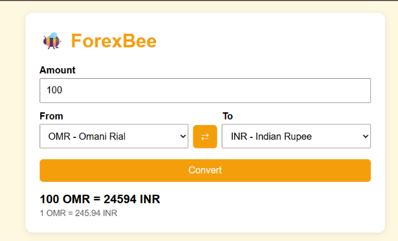
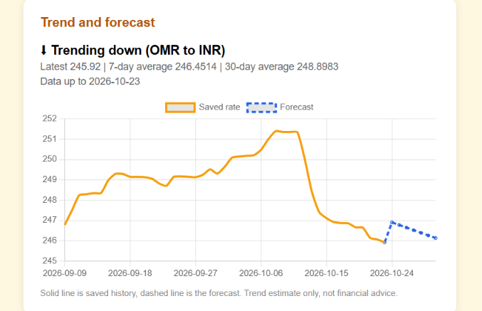
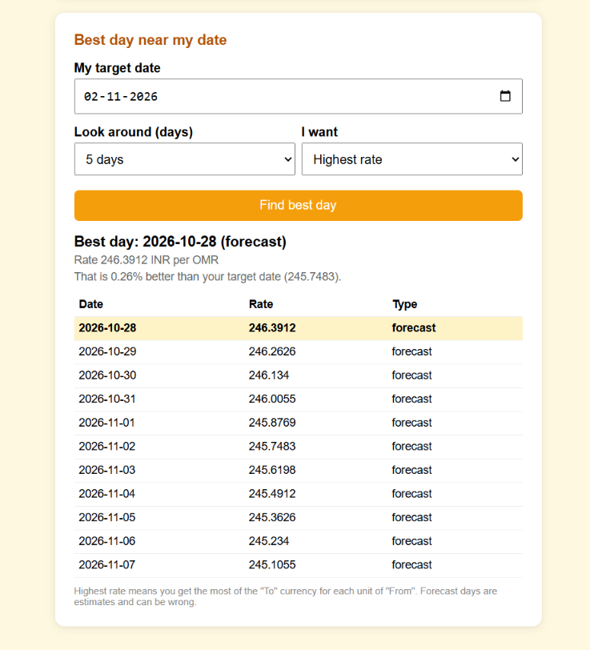

# 🐝 ForexBee

ForexBee is a multi-currency converter and rate tracker built with Java and Spring Boot. It checks exchange rates regularly, saves the history, estimates whether a rate is trending up or down, and suggests a good day to convert money near a date you choose.

## Screenshots

### Converter


### Trend and forecast


### Best day finder


## Features

- **Converter:** convert any amount between 200+ currencies (including OMR, INR, USD, EUR), with a swap button
- **Rate history:** daily rates are saved in a local database, and the last 90 days are loaded automatically for any pair you open
- **Auto refresh:** a scheduler refreshes every saved pair at start-up and again every day at 9 PM IST
- **Trend estimate:** shows UP, DOWN or FLAT with a chart of saved history and a 7-day forecast
- **Best day finder:** pick a target date and ForexBee suggests the best day around it (highest or lowest rate), using real saved rates for past days and the forecast for future days

## Tech stack

- Java 17+ and Spring Boot
- Spring Web (REST endpoints) and Spring Data JPA
- H2 database (stored in a local file, nothing to install)
- Plain HTML, CSS and JavaScript with Chart.js for the page
- Exchange rate data from the free [Frankfurter API](https://frankfurter.dev) (no API key needed)

## How to run

1. Install Java 17 or higher and Git
2. Clone the project:
```
   git clone https://github.com/<Afiya-Jamil>/forexbee.git
   cd forexbee
```
3. Start it:
```
   ./mvnw spring-boot:run
```
   (on Windows PowerShell use `.\mvnw spring-boot:run`)
4. Open http://localhost:8080 in your browser

The first start takes a little longer because it downloads 90 days of history.

## API endpoints

| Endpoint | What it does |
|----------|--------------|
| `/currencies` | List of supported currencies |
| `/rate?from=OMR&to=INR` | Latest rate for a pair |
| `/convert?amount=100&from=OMR&to=INR` | Convert an amount |
| `/history?from=OMR&to=INR` | Saved daily rates for a pair |
| `/predict?from=OMR&to=INR&days=7` | Trend direction and forecast |
| `/best-day?from=OMR&to=INR&date=2026-11-05&window=5&goal=high` | Best day around a date |

## How the prediction works

ForexBee takes the last 30 days of saved rates and fits a straight line through them (linear regression). The slope of that line decides if the trend is UP, DOWN or FLAT, and the line is extended forward to get the forecast. The 7-day and 30-day averages are shown alongside it.

## Limitations

- This is a **simple trend estimate, not a real prediction**. Exchange rates are driven by news, interest rates and markets, which this model does not know about.
- Forecasts only go up to 30 days ahead, and get less reliable the further out they are.
- Rates come as daily values, so nothing changes within a day.
- The scheduler only runs while the app is running. Missed days are filled in the next time it starts.
- Not financial advice.

## What I learned

- Building a REST API with Spring Boot (controllers, services, repositories)
- Calling an external API and saving the data in a database
- Scheduled tasks and back-filling missing data
- Linear regression in plain Java
- Connecting a Java backend to a web page

## Ideas for the future

- A "my money" tracker with totals across currencies
- Rate alerts
- Deploying it online so it runs 24/7